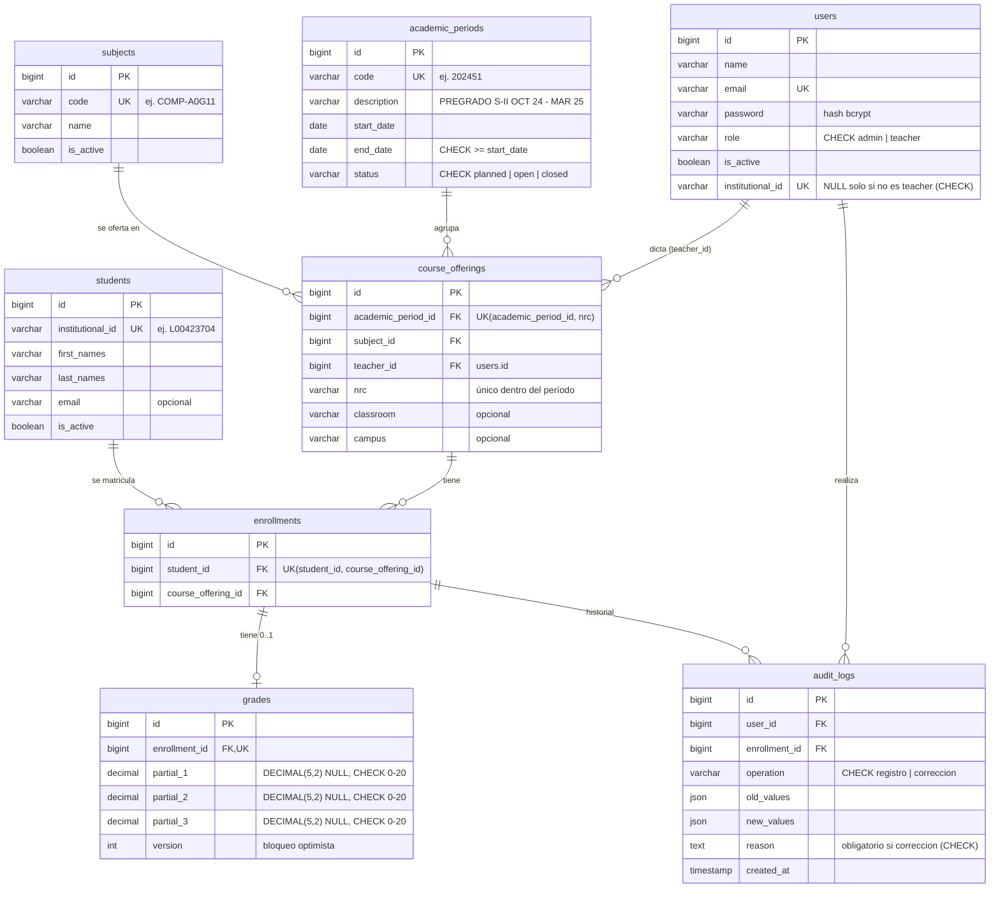

# Diagrama Entidad-Relación

Generado a partir de las migraciones en `database/migrations`. GitHub renderiza el
bloque Mermaid directamente.

## Notas de diseño

- **Claves técnicas vs. códigos institucionales.** Todas las tablas usan `id` autoincremental
  como PK. El ID institucional, el código de asignatura, el código de período y el NRC son
  columnas de texto con su propia restricción `UNIQUE`.
- **Forma normal.** El esquema está en 3FN: cada atributo depende solo de la clave de su
  tabla. Total, promedio y estado no se almacenan porque dependen de los parciales
  (serían dependencias transitivas y podrían quedar desactualizados).
- **Borrado.** Todas las FK son `ON DELETE RESTRICT`; los registros en uso se inactivan.
- **Índices.** Además de PK/UNIQUE: `course_offerings(teacher_id)` para "mis ofertas",
  `course_offerings(subject_id)`, `enrollments(course_offering_id)` para el listado y el
  reporte de un NRC, `students(last_names, first_names)` para ordenar, y
  `audit_logs(enrollment_id)` / `audit_logs(created_at)` para el historial.
- Las tablas técnicas `sessions` y `cache` de Laravel se omiten del diagrama.
